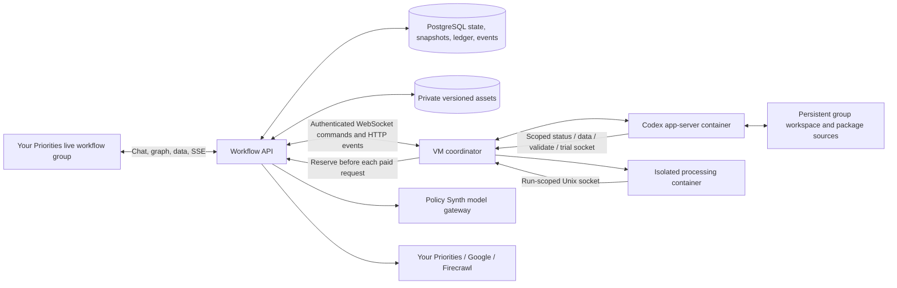

# Live workflows

Your Priorities groups can host a persistent Codex workspace and run versioned TypeScript agent packages on a VM. The first package is [Skills First](../workflow-packages/skills-first/README.md). Group members see direct Codex chat, private data, a live agent graph, and a spending ledger. Administrators configure the Codex model and allowances; the active operator selects processing models on the graph and approves runs. New workspaces default to `gpt-6-luna` for both, with independent selections. Existing workspaces and explicit package model choices are preserved.

This initial integration is **disabled by default**. It targets installations managed by the project owner, including yrpri.org and ypus.org, with a single API process owning the VM broker. Hosts are provisioned and migrations applied separately.

## Architecture



The VM agent, app-server transport, generated protocol contracts and Codex image recipe support Your Priorities live workflows. [PROVENANCE.json](PROVENANCE.json) records the Policy Synth source commit and original Skills First file hashes. The Rust patch uses Your Priorities names, with its checksum pinned in the image recipe and version manifest. The API, ledger, package runner and Lit interface are specific to Your Priorities. Processing agents run in containers on the same VM, without the old agent queue or a Chief Programmer.

One group is pinned to one host and package. One operator at a time controls Codex using their own ChatGPT credentials; another eligible operator must explicitly take over. Each operator has a separate resumable Codex thread. Processing API credentials stay on the API server and are billed separately from ChatGPT usage. Group workflow data, including shared chat, is visible to authorized group members, even if the ordinary group page is public.

## Authentication scope

Users first authenticate to Your Priorities, then connect their own ChatGPT account with a device code or supply an OpenAI API key for Codex. Both credential types are encrypted per user in PostgreSQL with AES-256-GCM. Changing credentials stops that user's existing Codex session and clears its thread association; disconnect removes the saved credentials. API-key mode is explicit, with no environment or automatic fallback. Processing agents use separately configured provider credentials and API billing; ChatGPT sign-in does not supply general API access. Administrators can nominate additional operator user IDs. Connector secrets are also encrypted and bound to their connector.

ChatGPT sign-in uses the Codex app-server device-code flow. The same flow is the deployment target for the owner-operated yrpri.org and ypus.org installations. No site registration, replacement login integration or domain allowlist is introduced by this port. Set the external API/UI origins and reverse-proxy routing for each installation; authentication remains the pinned Codex app-server implementation. Validate the full login/session lifecycle on each installation before enabling it for users.

## Build and install

Use Linux, Node 24, PostgreSQL and Docker with **both Sysbox (`sysbox-runc`) and standard `runc` available**. The Codex runtime uses Sysbox with inner Docker; processing and parsing containers explicitly use `runc`. Run the VM coordinator as a dedicated non-root OS account with Docker access and ownership of its private storage. Processing containers run as that account's UID/GID. The existing Your Priorities database/session infrastructure is required.

From `server_api`:

```sh
npm ci
npx tsc --noEmit
npm run typecheck:live-workflows
# Optional scoring of saved synthetic-benchmark outputs; no provider calls:
# npm run evaluate:skills-first -- /path/to/skills-first.json
npm run build:live-workflows
docker build -t yp-live-workflow/processing-runtime:1 -f live-workflow-runtime/Dockerfile.processing live-workflow-runtime
```

The runtime build emits a standalone `live-workflow-runtime/build` tree. Copy the runtime directory, including its package manifest and lockfile, to the host and run `npm ci --omit=dev` there. `npm start` in that directory starts the VM coordinator. Package snapshots arrive from the API; the VM does not need a checkout of either sibling project.

The Codex image is a lean, multi-stage development image. Its final stage has Node 24, TypeScript/tsx, Python, Git, basic build tools and inner Docker. It retains Codex 0.146.0, the pinned Rust patch and the pinned source/V8/bwrap checksums. Rust compilation and patch tests run in the builder; CUDA, R, scientific libraries and browser downloads are absent from the final image. Codex sessions and auth helpers default to CPU-only containers, without NVIDIA devices or GPU runtime requirements. The recipe currently targets amd64, matching the pinned V8 archive.

The image also preinstalls the small Skills First editing dependencies (`flesch-kincaid`, `syllable`, and Node type declarations) from [a separate lockfile](docker/package-lock.json). `/node_modules` exposes them to workspace packages, so `tsc --noEmit --project /workspace/package/tsconfig.json` works without installing anything during a session. The image smoke test typechecks the full package with networking disabled, then checks the app-server under runc and Sysbox. Processing still uses its own pinned runtime image and dependency contract.

```sh
docker build -t yp-live-workflow/codex-runtime:1 live-workflow-runtime/docker
# Requires both local Docker runtimes; no account, network or inference in test containers:
npm run test:live-workflows:codex-image
```

The smoke test checks image labels, CLI version, an app-server initialize/account-read exchange with a fresh temporary Codex home, and inner Docker under Sysbox. It never starts a model turn. The first source build can still take substantial time and disk; Cargo caches are build artifacts, separate from the final image. The build runs all four copied patch test selections. Debian’s musl wrapper needs an explicit `--no-dynamic-linker` flag for Rust static PIE; the recipe asserts that the final executable has no interpreter header (see [the Rust upstream issue](https://github.com/rust-lang/rust/issues/95926)). Keep the image and generated protocol contract in sync.

The local `20261011.1` build passed all nine patch tests and the offline app-server checks under both `runc` and `sysbox-runc`, including inner Docker startup. Docker reported a final image size of approximately 1.3 GB. The initial optimized Rust build took about an hour with four compiler workers; later builds reuse the Cargo caches. Repeat the smoke test on each installation before connecting accounts.

After copying the built runtime and installing dependencies, run `npm run check` as the VM service account. From the API checkout run `npm run check:live-workflows -- api` after `npm run build:live-workflows`. Checks inspect configuration, credential presence (never their values), private directory ownership, free space, Docker runtimes and installed image metadata. They do not contact accounts/providers, apply migrations or verify external routing. A nonzero exit means the listed local requirement is unmet.

[install/yp-workflow-vm.service](install/yp-workflow-vm.service), [install/vm.env.example](install/vm.env.example), and [install/nginx.conf.example](install/nginx.conf.example) are installation examples for the owner-operated services. Adjust executable paths and upstream ports to the existing host. Pre-create private storage directories with mode 0700 owned by the dedicated `yp-workflow` account; keep the environment file readable only by that account and the administrator. The unit checks readiness before starting. Nothing in this directory installs or enables the service automatically.

## API configuration

Set these in the API service environment, using your normal secret manager:

| Variable | Value |
| --- | --- |
| `YP_LIVE_WORKFLOW_ENABLED` | `true` to mount the feature |
| `YP_LIVE_WORKFLOW_AUTH_ENCRYPTION_KEY` | A stable base64-encoded 32-byte random key; back it up separately |
| `YP_LIVE_WORKFLOW_DATA_ROOT` | Absolute private, persistent directory for uploaded inputs and artifacts |
| `YP_LIVE_WORKFLOW_HOSTS` | JSON host registry, example below |
| `YP_LIVE_WORKFLOW_MODELS` | Optional replacement JSON processing-model registry; otherwise uses the backend's standard GPT-6 model definitions |
| `YP_LIVE_WORKFLOW_PACKAGE_ROOT` | Optional absolute package catalog path; defaults to the bundled `workflow-packages` |
| `YP_LIVE_WORKFLOW_PUBLIC_ORIGIN` | Optional external UI origin for same-origin checks behind a reverse proxy |

Example host record; replace the ID and token, and create the private root owned by the coordinator account:

```json
[
  {
    "id": "55555555-5555-4555-8555-555555555555",
    "name": "Workflow host 1",
    "token": "REPLACE_WITH_A_UNIQUE_RANDOM_TOKEN_OF_AT_LEAST_32_CHARACTERS",
    "rootPath": "/srv/yp-workflows",
    "image": "yp-live-workflow/codex-runtime:1"
  }
]
```

The default processing catalog shares [GPT-6 model definitions](../src/agents/managers/openAiGpt6Models.ts) with `NewAiModelSetup`: Luna, Sol and Astra, with standard pricing and `OPENAI_API_KEY` on the API service. Backend seeding retains its priority/flex variants; those aliases are not included in this workflow catalog. Workflow calls use reasoning mode, a 4,096-token output cap, and a conservative context bound below the backend's long-context surcharge threshold. Larger records must be split. Reservations cover cache-write pricing; settlement distinguishes ordinary, cached and cache-write input. Price versions are derived from the shared configuration, so updating it invalidates approvals without a second price table or a database-seeding race.

Set `YP_LIVE_WORKFLOW_MODELS` only to replace the default catalog (an explicit `[]` disables all processing models). Replacement registry **shape only**, not a price quote or a usable model ID:

```json
[
  {
    "id": "REPLACE_WITH_MODEL_ID",
    "label": "Processing model",
    "provider": "openai",
    "keyEnv": "YP_PROCESSING_OPENAI_API_KEY",
    "inputMicrosPerMillion": 2000000,
    "cachedInputMicrosPerMillion": 500000,
    "cacheWriteInputMicrosPerMillion": 2500000,
    "outputMicrosPerMillion": 8000000,
    "maxOutputTokens": 4096,
    "contextTokens": 128000,
    "priceVersion": "YOUR_VERIFIED_PRICE_REVISION"
  }
]
```

Providers are `openai`, `anthropic` and `google`. Set the corresponding `keyEnv` credential on the API service only. For OpenAI reasoning models include `"reasoning": true`. All prices and limits are integer USD microdollars: `1000000` is $1; token prices are microdollars per million tokens. Configure conservative rates covering the provider's actual context and output pricing. Missing models or credentials fail before spending. Changes to the public model definition invalidate existing approvals. Global Policy Synth Azure overrides, differing OpenAI override credentials, a custom `OPENAI_BASE_URL`, and forced EU routing are rejected for workflow OpenAI requests because they could change the approved billing identity or price.

Apply the additive migration explicitly with the existing API database configuration:

```sh
npm run migrate:live-workflows
```

It creates `yp_live_workflow_workspaces`, `yp_live_workflow_documents` and `yp_live_workflow_events`, with a group foreign key. The migration is transactional, serialized and repeatable. It does not change existing agent queue tables. Then start the API with the feature enabled and rebuild the Lit client as usual.

Route **all `/api/live-workflows` HTTP and WebSocket traffic to the same API process** for this first version. Budget locking works across PostgreSQL connections, but the WebSocket broker is in memory and is not a distributed service. Use TLS; allow `/api/live-workflows/vm/ws` WebSocket upgrades, disable proxy buffering for `/stream`, and accommodate the upload size and 15-minute upload timeout. Cookie-authenticated mutations require the correct same-origin header, including through your reverse proxy.

## VM configuration

Set these on the dedicated VM coordinator service, matching the API host record:

```sh
export YP_LIVE_WORKFLOW_API_BASE_URL=https://YOUR_YP_API_ORIGIN
export YP_LIVE_WORKFLOW_VM_HOST_ID=55555555-5555-4555-8555-555555555555
export YP_LIVE_WORKFLOW_VM_AGENT_TOKEN=YOUR_MATCHING_HOST_TOKEN
export YP_LIVE_WORKFLOW_VM_WORKSPACE_ROOT=/srv/yp-workflows
export YP_LIVE_WORKFLOW_VM_AGENT_STATE_PATH=/srv/yp-workflow-state/vm-agent-state.json
export YP_LIVE_WORKFLOW_VM_ARCHIVE_ROOT=/srv/yp-workflow-archive
export YP_LIVE_WORKFLOW_VM_DATASETS_HOT_ROOT=/srv/yp-workflow-datasets
export YP_LIVE_WORKFLOW_CODEX_ALLOWED_IMAGES=yp-live-workflow/codex-runtime:1
export YP_LIVE_WORKFLOW_CODEX_CONTAINER_IMAGE=yp-live-workflow/codex-runtime:1
export YP_LIVE_WORKFLOW_PROCESSING_IMAGE=yp-live-workflow/processing-runtime:1
export YP_LIVE_WORKFLOW_MIN_FREE_BYTES=1073741824
export YP_LIVE_WORKFLOW_DOCKER_RUNTIME=sysbox-runc
export YP_LIVE_WORKFLOW_DOCKER_RUN_USER=0:0
```

The Codex image starts an inner Docker daemon and therefore requires container-root, a writable container root filesystem and the supplied Sysbox configuration. Keep the supplied capability defaults for that container; using the processing container's restrictions on the Codex container will prevent startup. Container-root under Sysbox is separate from the non-root host coordinator account. Start `npm start` in the runtime directory under a service supervisor. Keep broker mode enabled and host-mode Codex disabled. The local control endpoint defaults to loopback; do not expose it publicly. Provider keys and the API encryption key do not belong on this VM.

Codex has its own group workspace and scoped control socket. Processing and document-parsing containers have no network, provider credentials, ChatGPT home, host token, or Docker socket. They use a read-only root filesystem, dropped capabilities, resource limits and scoped mounts. The processing gateway exposes only the approved run's model, connector, progress, artifact and status operations. Package source validation also runs in an isolated container.

## First group and run

1. Create a Your Priorities group with the **Live workflow** group type. In its Settings tab choose Skills First, a connected host, a Codex model ID, operator IDs, an overall processing allowance, a cumulative trial allowance, quota and concurrency. Model IDs can be refreshed from the authenticated Codex session after setup.
2. Connect ChatGPT from the Chat tab and claim control. A different operator must use explicit takeover; stopping the prior session is required before control changes.
3. Upload input files in Data, or bind a Your Priorities/Google input and import an immutable version. Select the versions to use. Ask Codex to inspect the data, adapt agent sources and keep the graph accurate.
4. Select the processing and review models on the Agents graph. Enable optional research/comparison stages and configure their bindings. Validate source changes before running.
5. Run a small trial of 1–20 records, either through one selected agent (including its dependencies) or through the whole enabled graph. The default cumulative trial allowance is $5 across the workspace, not $5 per attempt. Trials sample across input lengths and cannot write to external output bindings.
6. Draft a bulk run. It requires a completed, reconciled trial matching the source, graph, models, prices, data versions, connectors, concurrency and runtime image. Review the overall and per-agent projections and explicitly approve the dollar cap. A targeted trial only supports bulk approval for that same set of agents. Resolve any failed records before a trial can support bulk approval. Local outputs appear as downloadable data assets; external exports require named, write-enabled bindings.

Codex can invoke `node /workspace/.workflow/cli.js status`, `data [asset-id ...]`, `validate` and `trial [asset-id ...]`. It cannot approve bulk runs or raise budgets. `data` defaults to the latest version of each input and makes those files available under `/workspace/data`. A running source snapshot is immutable. Validation publishes updated package sources and graph for subsequent runs.

## Reviewing data and package revisions

The Results tab searches and paginates the final output of each new run or targeted trial. Filter failed, unknown, parent or child records, inspect original text/evidence, and compare two runs beside their saved model choices and costs. Stable record IDs match results; changed input versions or level identities appear unmatched. Reverse the comparison to inspect records unique to the other run. Older runs retain their downloadable artifacts but do not gain review indexes automatically. The runner publishes quota-accounted, checksum-verified JSON parts of at most 100 records and 1 MiB each; a single larger record must put its large content in a separate artifact. Arbitrary package output objects and scalar arrays are supported. Result search scans parts sequentially on the API, bounding memory; very large datasets may need a database search index in a later iteration.

Data previews show up to 20 records with bounded field lengths, including original text, proposed rewrites, citations and review notes. Parsing stays in the isolated processing container. Skills First title/description columns can be mapped from its normalize node. Codex can discover accessible Your Priorities groups, inspect connection capabilities, propose public binding settings for admin review, check bound data connections and import versioned data. Administrators approve or reject pending proposals in Data and supply credentials directly to the API; stale proposals cannot overwrite a changed binding. Administrators can also find groups, test read connections and disconnect bindings. The CLI accepts `trial --target <agent-id> --sample <1..20> [asset-id ...]`; Codex cannot approve bulk spending or connection access. Disconnect removes both current and saved-run access and pauses affected active runs; create a new trial after rebinding. An already accepted external request can still finish.

The graph inspector displays the selected run's saved settings as read-only. Switch to the current draft to edit. Validate Codex changes to save a content-addressed source revision; package history shows saved files and compares them against the last validated draft. Restore requires no active run or Codex turn, validates the saved code in isolation, and retains the replaced VM package in a `.package-backup-*` directory, including an invalid unsaved draft. Restore increments the draft revision and invalidates pending approvals; validate and create a new trial afterward. Uploaded input versions, finished outputs and audit records are unaffected.

## Spending and recovery

The gateway reserves a conservative cost bound atomically before every paid request and settles it using returned usage. The workspace row lock serializes concurrent reservations against agent, run, workspace and cumulative trial allowances. Optional agent caps are set in the graph; the graph and Usage panels show per-agent settled and reserved spending. When a paused run needs more allowance, the operator can explicitly approve new run and agent caps without changing its immutable sources or repeating completed requests. Models have bounded inputs and outputs; Firecrawl has an explicit credit bound. The OpenAI adapter uses Policy Synth's Responses model and usage accounting; provider requests have automatic paid retries disabled.

Estimates extrapolate the trial's observed cost and report sample coverage, per-parent cost range, standard deviation and the fraction of cost attributed to records. Skills First aggregates child-level work under the sampled parent using the optional SDK `withRecord` scope; zero-cost records remain in the sample. Shared/unattributed costs are spread evenly and flagged when material. The upper projection is the larger of 2x the mean and the mean plus two observed standard deviations, extrapolated to the population. This is a heuristic, not a confidence interval or statistical guarantee. Small, variable or poorly attributed trials recommend a larger sample (up to 20), or closer review with a smaller approved bulk allowance at that limit. Historical trials without attribution are labeled accordingly. Usage shows a live remaining/total forecast using trial per-agent projections, observed progress and outstanding reservations; crossing the forecast never raises an allowance. The approved cap is enforced independently. Configured rates must remain conservative: a provider that changes its prices, exceeds its stated token/credit bound, or bills outside the returned usage cannot be controlled by a local ledger alone. Provider account limits remain useful for large runs. ChatGPT subscriptions, VM hosting and storage are outside the processing dollar ledger.

Pause/cancel prevents new reservations and asks the VM to stop the container. Requests already accepted by a provider may finish and are still charged. An ambiguous provider timeout retains the reservation and pauses the run. Requests with unknown outcomes are never silently retried. Administrators reconcile the actual charge and known result in Usage, then an operator can resume from checkpoints or cancel. Reconciliation requires the provider's actual outcome; do not enter a fabricated success. An explicit increase to a run or agent allowance is recorded in the event log. If a Codex turn start loses its acknowledgement, restore is blocked until the turn ends or the operator uses Restart Codex session; the next chat resumes with the existing account and thread. Ordinary execution failures also pause the same run for recovery; they do not discard checkpoints or paid request identities. Invalid per-record model outputs in Skills First are repaired locally when possible, otherwise retained as unknown records with review notes and skipped by downstream model stages. Infrastructure and provider failures still pause execution.

VM events use a durable ordered outbox and API event keys deduplicate replay. After a VM restart, previously active containers are stopped and their runs pause for reconciliation. PostgreSQL, the API asset directory, the VM workspace and coordinator state/outbox directory all need durable storage and backups. Keep the encryption key available across restarts; rotating it requires re-encrypting stored credentials. Preserve processing image IDs while runs may be resumed.

## Current boundaries and verification

The [Skills First manual test](../src/liveWorkflows/tests/manual/README.md) covers hello, a two-job upload, the default package trial and browser downloads. Its offline rehearsal joins the real controller, disposable PostgreSQL, VM broker and processing container without importing credentials. The explicit live mode uses the supplied OpenAI key for Codex and processing in the test harness, with processing caps and saved result checks; product login also supports an explicit per-user API key. The separate on-demand `test:live-workflows:browser-manual` command leaves all interaction to a person or browser-control agent and tests API-key login through the production route using a server-side key import.

- Files: 250 MiB each, 15-minute streaming limit, default 10 GiB API asset quota per group. A run's parsed input is limited to 250 MiB in aggregate. CSV/TSV, JSON, text, Markdown, HTML, PDF and DOCX are supported. The quota covers API assets; VM workspaces, frozen runs and checkpoints need separately provisioned disk. A configurable free-space preflight (1 GiB by default) blocks snapshots, input preparation, restores and new runs when storage is low; it is not a filesystem quota. Settings → VM storage reports the host-wide available space and can remove up to 100 completed/cancelled processing snapshots older than 30 days. Paused, active, recent or unreconciled runs are excluded. API assets, source revisions and spending/event records remain; draft backups and Codex workspaces need operator-managed retention. Deleting an input removes its API blob and current Codex input cache; retained historical run snapshots can still contain it.
- Connectors: Your Priorities imports up to 10,000 posts and rechecks access. Google uses resource-bound service accounts; share the specific documents with that account. Drive imports at most 100 immediate text/Google Doc files per folder and 10 MB per file; upload PDF/DOCX directly. Sheets writes replace the configured range with RAW values; Docs writes append. These writes are available only in explicitly approved bulk exports. Your Priorities exports preserve the target group's default moderation status.
- Research: Firecrawl search is bounded to five results and one PDF page each. Optional full-document retrieval accepts only URLs from a settled search in the same run, node and binding. The approved graph sets documents per record (0–5), PDF pages per document (1–50), and text characters (1,000–200,000). Skills First defaults to two documents, ten pages and 60,000 characters. The gateway additionally caps total document requests per node at `maxDocuments × inputCount × 20`, allowing the maximum supported job-level expansion, and reserves the binding's credit bound before every request. The credit bound must cover requested pages plus two credits. Responses are limited to 2 MiB while receiving; this bounds API memory, not the original file size fetched by Firecrawl. Over-limit/ambiguous responses retain their cost reservation for reconciliation. Only Markdown and fast PDF text extraction are requested, without OCR or recursive crawling. Missing page totals, source errors, warnings, character truncation or partial PDFs remain incomplete; scanned PDFs need a separately reviewed import. Provider credit usage is required, never inferred from content. Request fields follow [Firecrawl's scrape reference](https://docs.firecrawl.dev/api-reference/endpoint/scrape).
- Package runtime: `sdkVersion: 1`, declared model roles (including `default`), optional local draft-07 JSON input/output schemas, arbitrary object/table input fields. Schemas are compiled with source validation; input is checked before agents execute, output after a full graph completes. The numeric fixture demonstrates a package without job-description fields. Trusted, fixed installed dependencies; no per-run dependency installation. SDK concurrency is cooperative, while money reservations are enforced by the gateway. Hosts are trusted infrastructure and can see the workspaces assigned to them.
- Validation: focused budget/auth/isolation/package tests; an explicit compatible subset of protocol/runtime tests; PostgreSQL concurrency tests; container execution of every Skills First stage using fixture providers; and browser checks of the Lit interface. Real ChatGPT device login and real provider/connector accounts still require an installation smoke test. The lean Codex image has a separate offline handshake and Sysbox smoke command; record its outcome for each installation.
- Upstream tests: the copied suite is preserved for porting reference. Running it wholesale currently includes tests tied to unported infrastructure, removed automatic API-key fallback modes and sandboxed localhost operations; it is not all green. `test:live-workflows:ported` identifies the supported compatibility subset.
- Dependency audit: the standalone runtime had no high/critical advisories at implementation time. Three moderate advisories remain in Mammoth's `argparse`/`sprintf-js` chain; document parsing runs inside the constrained, networkless container. Recheck the lockfile audit when installing or updating dependencies.

From `server_api`, run:

```sh
npm test # existing API tests plus focused live-workflow tests
npm run test:live-workflows:ported
npm run test:live-workflows:browser # fixture UI, Chromium required
npm run typecheck:live-workflows
# Optional scoring of saved synthetic-benchmark outputs; no provider calls:
# npm run evaluate:skills-first -- /path/to/skills-first.json
npm run build:live-workflows
npm run test:live-workflows:container
```

Install the browser dependency with `npx playwright install chromium` before the browser suite. Browser tests block all non-loopback requests and cover review/search/comparison, connection approval/import, binary uploads, targeted trials, bulk approval, pause/resume, member permissions, Codex questions and stream reconnection.

The container test requires Docker and the built processing image and uses fixture model responses, without provider calls. `npm run test:live-workflows:postgres` requires `YP_WORKFLOW_TEST_DATABASE_URL` pointing to a **fresh disposable** PostgreSQL database; never use the application database. `npm run preview:live-workflows` serves a fixture-backed UI on `127.0.0.1:54822`. Also run `npx tsc --noEmit` in both `server_api` and `webApps/client`.
