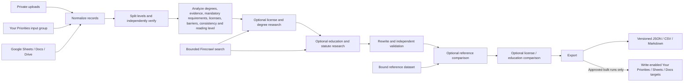

# Skills First package

Skills First analyzes job descriptions, researches qualifications, rewrites unnecessary barriers and exports reviewable results. It is the first `yp-live-workflow-v1` package. Its TypeScript agents replace the former queue/database-bound agents from `policy-synth/projects/skillsFirst`; the original review criteria and education/license taxonomies are retained in `source/prompts.ts` and the taxonomy modules. The copied source provenance is in [PROVENANCE.json](../../live-workflow-runtime/PROVENANCE.json).

[AGENTS.md](AGENTS.md) tells Codex how to inspect data, change these agents, maintain the graph, validate changes and request trials. [The runtime guide](../../live-workflow-runtime/README.md) covers installation, authentication, allowances and recovery.

## Initial logical diagram



Disabled processing stages pass the preceding enabled stage's result through. The default is normalize → split levels → analyze → rewrite → export. [graph.json](graph.json) is the executable graph and the source for the live UI; keep it current when adding or changing agents. The diagram above is the initial overview, not a separate execution engine. Live node progress and child tasks are reported by the runtime.

Each processing node's `description` explains its prerequisites. Edges enforce the order between agents. Inside `analyze`, tasks execute as degrees → evidence → mandatory → licenses → barriers → consistency → readingLevel by default. Evidence review consumes degree findings; consistency consumes degrees, evidence, mandatory, licenses and barriers. The other tasks read the job independently. These internal prerequisites are enforced in `source/analysis.ts`.

For an early, small experiment, set `analyze.configuration.tasks` to `["evidence"]` and request `trial --target analyze --sample 2`. The runtime includes normalize and levels, then the analysis agent runs degrees before evidence and stops. A consistency-only selection includes all five prerequisite tasks automatically. Invalid or empty selections fail before model calls. Omit `tasks` to run all seven. Partial analysis remains suitable for targeted experiments; restore the full selection before evaluating the whole rewrite pipeline. The last selected stage still has downloadable JSON results without invoking the export node.

For a nested or unfamiliar source format, Codex can add a deterministic adapter before normalize, with its own TypeScript entrypoint, graph description and input edges. Preserve IDs/source and all duties/qualifications, and save the adapted standard records through `context.artifact`. Uploaded asset versions stay immutable. The [headless manual suite](../../src/liveWorkflows/tests/manual/README.md) exercises this conversion through chat and checks the exact early-analysis dependency chain.

## Agents

| Node | Source | Behavior |
| --- | --- | --- |
| `normalize` | `source/normalize.ts` | Preserves original text and provenance, validates IDs, applies jurisdiction |
| `levels` | `source/levels.ts` | Extracts shared and level-specific passages, independently reviews coverage, emits separately processed jobs with stable IDs and original lineage |
| `analyze` | `source/analysis.ts` | Seven cited analyses per level and computed Flesch–Kincaid grade |
| `licenses` | `source/research.ts` | Optional bounded query planning, authority selection, exact-quote extraction, synthesis, follow-up and independent review of license/degree requirements |
| `education` | `source/research.ts` | Optional statutory education and barrier research |
| `rewrite` | `source/rewrite.ts` | Rewrites using analysis and evidence, then independently checks duties, legal requirements, inclusion, readability and facts; at most three attempts |
| `compare` | `source/compare.ts` | Optional comparison against an immutable reference dataset snapshot |
| `compare-license` | `source/compare.ts` | Optional comparison between license and education findings |
| `export` | `source/export.ts` | JSON, formula-safe CSV and Markdown; bounded multipart output for larger runs; explicitly bound bulk exports |

Missing evidence produces `unknown`, not a finding that a requirement does not exist. Analysis quotes must occur in the original text. Research citations must occur in the supplied source content and point to the matching URL. Rewrites that fail validation retain the original text, errors and unknown status. Malformed responses receive local JSON syntax repair before validation; no extra paid request is issued for that repair. Invalid per-record outputs are checkpointed with review notes and skipped by subsequent model stages. A trial with failed records cannot authorize a bulk run. Provider/network failures pause the run for recovery. Research retrieval timestamps are persisted with search results so replay uses identical model inputs. These checks establish traceability; they do not replace a human review of employment or legal policy.

New workspaces assign `gpt-6-luna` to agents without an explicit model selection. Change each model-calling node's `default` model in the graph independently of the group's Codex model. `rewrite` and comparison nodes can also select a separate `review` model; an empty review selection uses the default. Normalize and export do not call a model. The package template keeps model IDs configurable; the backend supplies prices from its shared model definitions.

## Inputs

Upload CSV/TSV, JSON, text, Markdown, HTML, PDF or DOCX, or import a connector snapshot in the Data tab. Table data should have `id`, `name`, `text` and optionally `jurisdiction`/`source`. `title` and `description` are accepted aliases. For other column names, set the Title column and Description column on the normalize node (stored as `configuration.fields.name` and `configuration.fields.text`). Preview imported records before running a trial. Plain documents become records with their filename as the title. Uploaded versions and checksums are frozen into each run; editing a Google document later does not mutate that input version.

```json
[
  {
    "id": "technician-1",
    "name": "Maintenance Technician",
    "text": "Maintain equipment and document repairs. A relevant license is required where prescribed by law.",
    "jurisdiction": "New Jersey, USA",
    "source": "Example job description"
  }
]
```

The default jurisdiction is New Jersey. Change `normalize.configuration.jurisdiction` for another jurisdiction; a record-specific value takes precedence. The research prompt uses the chosen jurisdiction instead of jurisdiction-specific examples in the older criteria. Research remains disabled until deliberately enabled and configured.

## Connector bindings

Codex can discover accessible groups, inspect bindings, propose a connection, check an approved data connection, and import a versioned snapshot. Pending proposals appear in Data for admin approval or rejection; the proposal contains only public settings. Administrators supply credentials separately, review write permissions and Firecrawl prices, and approve the exact proposed binding. Concurrent updates invalidate stale proposals. Codex cannot approve connections or bulk spending.

Use the Your Priorities group picker in Data, or create advanced bindings with non-secret binding JSON and a separate credential JSON. Test read access and disconnect bindings from the same panel. Secrets are encrypted on the API and never enter package files or prompts. Binding IDs are stable references from graph configuration. Updating a binding invalidates previous run approvals.

An input Your Priorities group:

```json
{"id":"source-group","label":"Job descriptions","kind":"your-priorities","resourceId":"123","writeEnabled":false,"settings":{}}
```

Use `{}` for its credential JSON. The user must have access to that group. Importing creates a versioned data asset; select that version for the trial.

A Google Sheet:

```json
{"id":"jobs-sheet","label":"Job descriptions sheet","kind":"google-sheets","resourceId":"YOUR_SPREADSHEET_ID","writeEnabled":false,"settings":{"range":"Jobs!A1:F10001"}}
```

For all Google bindings, provide the service account's `client_email` and `private_key` in the credential field and share the resource with that account. Use `google-docs` or `google-drive` with the corresponding document, file or folder ID. Drive is input-only. The first Sheets row supplies column names.

A Firecrawl research binding, with **illustrative credit pricing only**:

```json
{"id":"firecrawl","label":"Web research","kind":"firecrawl","resourceId":"web","writeEnabled":false,"settings":{"creditMicros":1000,"maxCreditsPerRequest":17}}
```

Its credential shape is `{"apiKey":"YOUR_FIRECRAWL_KEY"}`. Replace `creditMicros` with a conservative, verified cost per credit for your account. Search requires a bound of at least `2 + 3 × resultLimit` credits (17 allows five results). The implementation requests web results with scraped Markdown, caps PDF extraction at one page and settles reported `creditsUsed`. It does not enable recursive crawling. Consult [Firecrawl search costs](https://docs.firecrawl.dev/features/search) and [the search API](https://docs.firecrawl.dev/api-reference/endpoint/search) when setting prices and bounds.

For each research node, enable it and configure:

```json
{"topic":"professional license and degree requirements","firecrawlBinding":"firecrawl","maxPages":3,"queriesPerRound":2,"maxSources":4,"maxFollowupRounds":1,"maxDocuments":2,"maxDocumentPages":10,"maxDocumentChars":60000}
```

`maxPages` is the number of results per query, capped at five. Queries per round are bounded at four (default two), sources at ten (default four), and follow-up rounds at two (default one). Defaults permit at most four searches and four source extractions per record and research node. Each stage uses stable request IDs for checkpoint recovery. The trace records queries, chosen sources, authority/jurisdiction assessments, extractions, conflicts, reviewer decisions and exhausted limits. Known results require cited, applicable primary evidence; secondary-only, conflicting, missing, truncated or unresolved evidence stays unknown. PDF search excerpts are incomplete until bounded full-document retrieval proves page coverage. Up to `maxDocuments` selected primary sources per record can be retrieved through the same Firecrawl binding, with stable request IDs and `maxDocumentPages`/`maxDocumentChars` limits. Defaults are two documents, ten PDF pages and 60,000 characters; `maxDocuments:0` disables retrieval. The API requires a settled search that observed the URL, reserves credits, bounds response bytes, and enforces a total request ceiling independently of the package loop. Configure the binding credit maximum to cover the page limit plus two credits. Missing PDF page counts, provider warnings, page or text limits remain explicit in the stored coverage and research trace. Only fast PDF text extraction is requested; scanned or larger documents need a separately reviewed upload. No recursive crawl or OCR is enabled. A partial source cannot establish that a requirement is absent. Verified supplemental statute excerpts can be supplied through `configuration.statutes` as `[{"url":"...","text":"...","retrievedAt":"..."}]` and become part of the approved source snapshot.

For reference comparison, bind a read-only source and set `compare.configuration.referenceBinding` to its ID. Alternatively put a small reference array in `configuration.reference`. A missing reference is recorded as unknown without calling a model. The runtime freezes bound reference contents before trial and bulk approval.

For an output, create a separate binding with `writeEnabled:true`, and add its ID to `export.configuration.outputBindings`:

```json
{"outputBindings":["results-sheet","results-group"]}
```

Your Priorities output requires administration of the target group. Google Sheets output should bind an explicit A1 range large enough for ten columns and all records plus a header, such as `Results!A1:J10001`; chunked writes remain inside that rectangle and use RAW values. Google Docs output appends. Trials always keep exports local, even if output bindings are configured. External exports include only complete records without errors; local artifacts retain all records for review. Bulk exports use stable request IDs so an ambiguous external write must be reconciled before it can be retried. Large local exports use numbered files and a `skills-first-manifest.json` index.

## Evolving the package with Codex

1. Inspect the data and graph, then edit TypeScript under `/workspace/package/source`. Each agent exports `run(context, input)` as defined in `source/sdk.ts`.
2. Use `context.model`, `connector`, `progress`, `checkpoint`, `restore` and `artifact`. `processJobs` scopes paid calls through optional `context.withRecord(parentId ?? id, work)` so concurrent child work is attributed correctly. Keep that scope when adding custom record loops. Stable request keys must identify the same logical request across resume. Never attach credentials or call paid providers directly.
3. Add a stable graph node ID, `source/*.ts` entrypoint, model roles, configuration, position and edges when creating a new processing agent. The graph must be acyclic. One upstream enabled agent supplies its result directly; multiple upstream agents supply an object keyed by node ID. A root agent receives the selected original records.
4. Run `node /workspace/.workflow/cli.js validate`. Validation captures the allowed files, typechecks a read-only copy in a networkless container, and publishes the new draft graph. Use `trial --target licenses --sample 5 [asset-id ...]` (omit `--target` for the whole graph) for a small experiment; the user approves a new bulk run in the UI.

Source snapshots allow up to 500 files, 1 MB per file and 8 MB in aggregate, including `source/**/*.ts`, schemas, versioned `evaluation/*.json`, manifest, graph, package/TypeScript configuration, these instructions and the README. Symlinks and paths outside the package are rejected. Dependencies come from the fixed runtime image; changing `package.json` does not install dependencies. Coordinate dependency changes with a runtime image update and a new trial.

To add a different package, create a sibling folder with the same manifest/runtime contract, instructions, graph, TypeScript sources and schemas. The API catalog discovers it automatically. Existing workspaces remain pinned to their original package; new groups can select the new one.

## Acceptance before large runs

The old Skills First project supplies criteria and taxonomy. Version 1.1 added independent job-level processing and staged research. Version 1.2 adds bounded document retrieval, result review and parent-record cost attribution. Version 1.2.1 replaces conflicting legacy output instructions in analysis and rewriting with a single JSON response contract, retaining the original prompts for provenance. Each child retains `parentId`, `parentName`, `level` and byte-for-byte `originalText`; its current `text` contains only verified shared and level-specific passages. Downstream model inputs omit the full parent text. JSON/CSV exports retain lineage, and `skills-first-level-map.json` maps inputs to outputs. A failed split keeps the parent unknown with an explicit error. The graph reports both input and output counts when a stage expands the dataset.

[evaluation/cases.json](evaluation/cases.json) is a versioned synthetic benchmark covering ten scenarios: single-level mandatory requirements, two levels, missing sources, conflicting sources, wrong jurisdiction, unsupported citations, rewrite failure, incomplete splitting, alternate columns and long descriptions. Offline integration tests run the agent pipeline against deterministic responses and score saved outputs for coverage, lineage, source preservation, citations, unknown status and qualification retention. This checks engineering behavior, not the semantic accuracy of real models.

To score exported benchmark results without calling providers, run from `server_api`:

```sh
npm run evaluate:skills-first -- /path/to/skills-first.json
# Pass all numbered JSON result parts for multipart exports.
```

The command returns a JSON report and exits nonzero for failed cases, duplicate identities or unexpected records. `source/evaluate.ts` contains the scoring contract. Real output quality still needs expert-reviewed examples and small account-backed trials when live runs are authorized. Before large spending, validate actual connector access, observed per-agent costs, pause/resume and unknown-outcome reconciliation on that installation.

Use targeted trials to evaluate an individual stage together with its dependencies. Model choice, configuration and optional per-agent caps are editable from the current draft graph. Package history retains validated revisions for comparison and restore; a changed revision needs a fresh trial.

## Development checks

Version 1.3 adds node dependency descriptions and targeted internal analysis tasks. Rebuild the processing runtime image with the current server modules when upgrading, so its graph validator accepts the descriptions and shares the API's dependency ordering.

From `server_api`, run `npm run typecheck:live-workflows`, `npm run test:live-workflows` and the fixture-backed processing container smoke test described in the runtime guide. Fixtures exercise all nine stages, including the optional research and comparison paths, without charging provider accounts. This package ships under the copied MIT license in [LICENSE](LICENSE).
